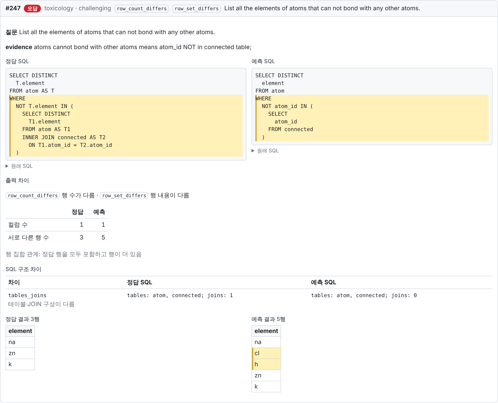

# text2sql-eval

[](https://github.com/cheolkim02/text2sql-eval/actions/workflows/ci.yml)

**English summary.** `text2sql-eval` is a Python library and CLI for the error analysis of text-to-SQL experiments. Given a BIRD-style dataset, SQLite databases and a file of predicted SQL, it judges execution accuracy (EX) exactly like BIRD's official script; on the bundled example its numbers match the official script to two decimals. It then explains every wrong case without using an LLM: how the executed results differ, and where the SQL differs, with evidence. It flags verdicts that the official rule may get wrong, such as an answer that returns every gold row plus an extra column. It also compares two runs case by case and writes an offline HTML report and an Excel-ready CSV. Everything is deterministic: the same inputs give the same output. Install it with `pip install text2sql-eval` (Python 3.11+). Documentation is in Korean.

text-to-SQL 실험의 예측 파일을 받아 **EX(실행 정확도)를 판정하고, 오답이 정답과 무엇이 다른지를 AI 없이 근거와 함께 보여 주는** Python 라이브러리이자 CLI다.

## 왜 만들었나

text-to-SQL 연구를 하면서 실험을 돌리는 것보다 결과를 판단하는 데 시간이 더 오래 걸렸다.

- **오답 분석을 손으로 했다.** 틀린 케이스마다 정답과 예측 SQL을 읽고, 다른 곳을 찾아 엑셀에 적고, 카테고리를 붙였다. 질문이나 SQL이 길면 읽기조차 힘들었다.
- **분류를 AI에게 맡길 수 없었다.** 평가 결과를 LLM이 분류하면 그 분류에도 오류가 섞여, 평가를 믿을 수 없게 된다.
- **EX 판정 자체가 틀린다.** 정답 결과가 비어 있으면 빈 결과를 내는 아무 SQL이나 정답이 된다. 사람 이름을 물었을 때 이름과 성을 한 컬럼으로 이어 붙여 내면, 내용이 맞아도 오답이 된다.
- **실험 비교도 손으로 했다.** 두 설정에서 둘 다 틀린 문제, 한쪽만 틀린 문제를 스크립트로 뽑아 눈으로 봤다.

그래서 "무엇이 다른가"는 도구가 규칙으로 보고하고, "왜 틀렸나"는 사람이 판단하도록 나눴다.

## 무엇을 하나

- **EX 판정:** BIRD 공식 스크립트와 같은 규칙(행 집합 비교)으로 판정한다. 같은 예측을 공식 스크립트로도 채점해 숫자가 같음을 확인했다.
- **오답의 차이:** 오답마다 두 가지를 근거와 함께 붙인다. 한 오답에 여러 개가 붙을 수 있다.
  - 출력 차이 6종: 빈 결과, 컬럼 수, 행 수, 값 하나, 행 내용, 실행 실패
  - SQL 구조 차이 5종: WHERE 값, 테이블·JOIN, 컬럼, 집계, ORDER BY/LIMIT
- **판정 신뢰도 플래그:** 공식 규칙이 놓쳤을 수 있는 판정 6가지를 표시한다(거짓 정답 의심, 거짓 오답 의심). 판정 자체는 바꾸지 않는다.
- **두 실행 비교:** 케이스 단위 분할표(고쳐짐, 나빠짐), 난이도별·DB별 EX, 차이 분포의 변화를 보여 준다. 기준보다 나빠지면 실패하게 해서 CI에서도 쓸 수 있다.
- **리포트:** 인터넷 없이 열리는 HTML 한 파일과, 엑셀에서 한글이 깨지지 않는 CSV를 만든다. HTML은 정답·예측 SQL을 절마다 줄을 나눠 나란히 보여 주고, 다른 절과 다른 행을 색칠한다.

판정과 분석에 LLM, 무작위, 시간에 따라 달라지는 값을 쓰지 않는다. 같은 입력이면 같은 결과가 나온다.



HTML 리포트에서 오답 하나(#247)를 펼친 화면이다. 정답과 예측 SQL에서 다른 절(WHERE)과, 정답에 없는 예측 결과 행(`cl`, `h`)을 칠한다. 출력 차이(`row_count_differs`, `row_set_differs`)와 SQL 구조 차이(`tables_joins`)를 근거와 함께 보여 준다. 리포트 전체는 [examples/results/report.html](examples/results/report.html)이다. 내려받아 브라우저로 열면 된다.

## 3분 사용법

Python 3.11 이상이 필요하다. 저장소에 BIRD dev의 DB 3개와 문제 432개, gpt-4o-mini의 예측 두 벌이 들어 있어서 받자마자 돌려 볼 수 있다.

```sh
git clone https://github.com/cheolkim02/text2sql-eval.git
cd text2sql-eval
python -m venv .venv && . .venv/bin/activate
pip install .
```

판정하기(30초쯤 걸린다):

```sh
text2sql-eval eval \
  --dataset examples/bird-mini/dev.json \
  --db-dir examples/bird-mini/dev_databases \
  --pred examples/results/gpt-4o-mini-evidence.jsonl \
  --tied examples/bird-mini/dev_tied_append.json \
  --out runs/evidence.json
```

```text
Evaluated 432 cases: EX 61.8% (267 correct, 161 incorrect, 4 errors)
Output difference: 62 column_mismatch, 58 row_set_differs, 44 single_value_differs, 34 empty_result, 31 row_count_differs, 4 execution_failed
SQL structure difference: 79 columns, 72 tables_joins, 66 aggregation, 25 where_value, 23 order_limit
Flags: 8 gold_columns_concatenated, 25 gold_rows_with_extra_columns, 5 matches_tied_alternative_only, 13 tied_alternative_exists
Run file: runs/evidence.json
```

리포트 만들기(`runs/evidence.html`을 브라우저로 연다):

```sh
text2sql-eval report runs/evidence.json --html runs/evidence.html --csv runs/evidence.csv
```

evidence를 뺀 실행과 비교하기:

```sh
text2sql-eval compare examples/results/gpt-4o-mini-no-evidence.run.json runs/evidence.json
```

uv를 쓰면 `pip install .` 대신 `uv sync`를 하고, 명령 앞에 `uv run`을 붙인다. 자세한 안내는 [시작하기](docs/guides/getting-started.md)에 있다.

예제 없이 내 실험에만 쓰려면 저장소를 받지 않고 PyPI에서 설치하면 된다.

```sh
pip install text2sql-eval
```

내 실험의 결과를 넣으려면 예측을 한 줄에 SQL 하나인 텍스트나 JSONL로 쓰면 된다([예측 파일 만들기](docs/guides/prediction-format.md)). 같은 일을 Python에서 하려면 `text2sql_eval.evaluate_files`를 쓴다([API](docs/reference/api.md)).

## 실측 결과

저장소에 커밋된 baseline이다. `examples/bird-mini`(BIRD dev, 432문제)에서 gpt-4o-mini로 같은 프롬프트를 두 번 돌렸고, 다른 점은 BIRD의 `evidence`(힌트)를 넣었는지 하나다.

| 설정 | EX | simple | moderate | challenging | BIRD 공식 스크립트 |
| --- | --- | --- | --- | --- | --- |
| evidence 있음 | **61.81%** | 68.22% | 54.62% | 47.27% | 61.81% (일치) |
| evidence 없음 | **37.50%** | 43.80% | 27.73% | 29.09% | 37.50% (일치) |

- **공식 스크립트와 일치:** 공식 평가 스크립트를 수정하지 않고 같은 예측을 채점했다. 난이도별 숫자까지 8개가 모두 소수점 둘째 자리까지 같다.
- **거짓 오답 의심:** evidence 있음 실행의 오답 161개 중 38개(24%)에 플래그가 붙었다. 공식 규칙으로는 오답이지만 사람이 보면 맞다고 할 만한 답이다. 예를 들어 #1445는 이름과 성을 한 컬럼으로 이어 붙였고, #300은 원자 id에 원소 컬럼을 덧붙였다.
- **두 실행 비교:** evidence를 넣자 123개가 맞게 바뀌고 18개가 틀리게 바뀌었다(+24.3%p). `where_value` 차이가 132개에서 25개로 가장 많이 줄었다. evidence가 주로 WHERE에 들어갈 값(철자, 대소문자, 코드값)을 알려 주기 때문이다.

생성 조건, 비용, 시간 제한에 민감한 케이스는 [examples/results](examples/results/README.md)에 있다.

## 문서

| 문서 | 내용 |
| --- | --- |
| [시작하기](docs/guides/getting-started.md) | 설치부터 예제로 `eval → report → compare`까지 |
| [예측 파일 만들기](docs/guides/prediction-format.md) | 내 파이프라인의 결과를 넣는 법 |
| [결과 읽기](docs/guides/reading-results.md) | 판정 규칙, 차이와 플래그의 뜻, HTML 리포트, CSV로 손 분류하기 |
| [실행 비교하기](docs/guides/comparing-runs.md) | 비교 결과 해석, CI에서 쓰기 |
| [CLI 레퍼런스](docs/reference/cli.md) | 명령과 옵션, 종료 코드, 출력 형식 |
| [API 레퍼런스](docs/reference/api.md) | 공개 Python API 38개 |
| [실행 파일 형식](docs/reference/run-file.md) | `eval`이 쓰는 JSON |
| [아키텍처](docs/architecture.md) | 모듈 경계, 의존 방향, 설계 원칙 |
| [기여 안내](CONTRIBUTING.md) | 개발 환경, 검사, 커밋 규칙 |

## 품질

- **타입:** pyright strict에서 오류가 0개다. 공개 API에 `Any`가 없고, 타입 정보(`py.typed`)를 함께 배포한다.
- **CI:** GitHub Actions에서 다음을 돌린다.
  - Ruff 린트와 포맷 검사, pyright
  - Python 3.11~3.15 테스트
  - 빌드한 wheel을 개발 도구 없는 새 환경에 설치해 CLI를 실제로 돌려 보기
- **테스트:** 단위 테스트, Hypothesis 속성 기반 테스트, 실제 프로세스로 돌리는 e2e 테스트가 있다. 그 밖에 이런 것을 지킨다.
  - 커밋된 baseline이 예측 파일에서 그대로 다시 나오는지
  - 문서가 코드와 어긋나지 않는지

## AI와 함께 만든 방식

이 저장소는 Claude Code와 함께 만들었다. 역할은 [AGENTS.md](AGENTS.md)에 정해 두었다. 사람이 설계를 결정하고 리뷰하며, 에이전트는 선택지를 제시하고 구현·테스트·문서 초안을 맡는다.

- **설계 결정은 모두 사람이 했다.** 공개 API, 의존성, 파일 형식, 판정·차이·플래그 규칙, 도구 선택이 결정 대상이다. 에이전트가 선택지와 장단점을 표로 제시하고, 사람이 고르면 그 자리에서 결정 기록(ADR)을 남긴다. [결정 기록 45개](docs/decisions/README.md)는 모두 결정자가 사람이고, 사람이 한 말을 그대로 인용한다. 에이전트의 추천을 고르지 않은 결정도 그대로 적었다. 예를 들어 Ruff 규칙 세트, baseline 모델, 통계 검정을 넣지 않기로 한 것이 그렇다.
- **작게 나눠 검토했다.** 기능마다 순서를 지켰다.
  1. 계획 승인
  2. 테스트와 구현
  3. 자가 검토 체크리스트
  4. 사람의 diff 검토
  5. PR, CI 통과 후 merge
- **기록:** AI가 함께 쓴 커밋에는 `Co-Authored-By`를 붙였다.

역할 분담, 사람이 기각한 추천, AI가 틀린 대표 사례와 그것을 잡은 방법은 [AI와 함께 개발한 방식](docs/ai-workflow.md)에 정리했다.

## 한계와 로드맵

- **실행 엔진:** SQLite만 실행한다. PostgreSQL·MySQL은 로드맵이다.
- **판정:** BIRD 공식 규칙 하나로만 판정한다. 행 순서와 중복까지 따지는 엄격 모드는 로드맵이다.
- **정규화:** SQL 구조 차이의 정규화는 최소한이다. 조건 순서, `IN`과 `EXISTS`, 서브쿼리와 JOIN처럼 뜻은 같고 모양이 다른 SQL은 다르게 본다.
- **카테고리 매핑:** 사용자가 정한 카테고리를 파일로 자동으로 붙이는 기능은 로드맵이다. 지금은 CSV의 `my_category` 열에 손으로 적는다.

## 라이선스

- 코드: [MIT](LICENSE)
- 예제 데이터 `examples/bird-mini`: [BIRD](https://bird-bench.github.io/) dev의 일부, [CC BY-SA 4.0](examples/bird-mini/LICENSE)(출처와 바꾼 점은 [SOURCE.md](examples/bird-mini/SOURCE.md))
