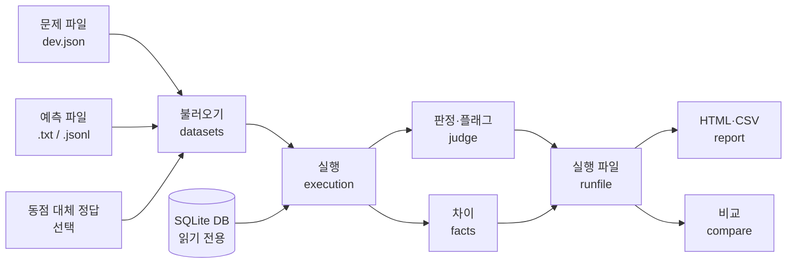
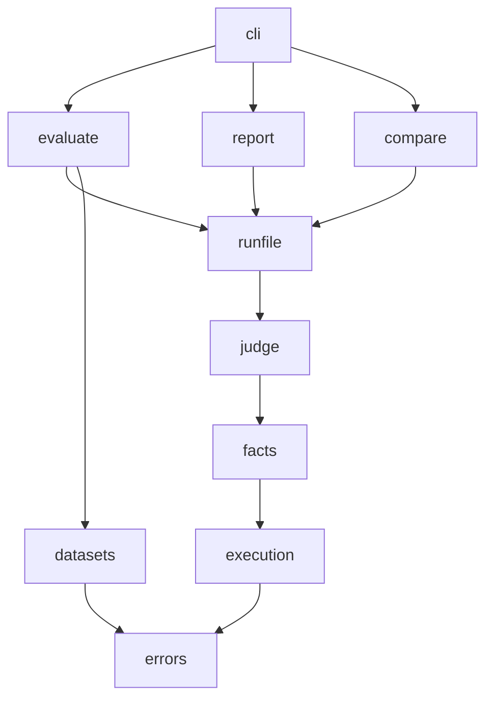

# 아키텍처

이 문서는 코드를 고치려는 사람을 위한 지도다. 무엇이 어디에 있고, 왜 그렇게 나눴는지 설명한다. 사용법은 [가이드](guides/getting-started.md)에 있다.

## 데이터 흐름

1. **불러오기:** 문제 파일과 예측 파일을 읽고 검증한다. 잘못된 곳이 있으면 파일, 줄, 고칠 방법을 담은 `InputError`를 낸다.
2. **실행:** 케이스마다 정답 SQL, 예측 SQL, (있으면) 동점 대체 정답 SQL을 실행한다. 모든 쿼리를 한 스레드 풀에 넣어 느린 쿼리가 나머지를 막지 않게 한다.
3. **판정:** BIRD 공식 규칙(행 집합 비교)으로 판정하고, 의심스러운 판정에 플래그를 붙인다.
4. **차이:** 정답이 아닌 케이스에 출력 차이(결과 비교)와 SQL 구조 차이(파싱 비교)를 붙인다.
5. **실행 파일:** 1~4의 결과와 입력 파일 해시, 설정, 메타를 JSON 하나로 쓴다. 결과 행은 앞 20행만 남긴다.
6. **리포트·비교:** 실행 파일만 읽는다. DB나 예측 파일은 다시 보지 않는다.

`eval`과 `report`·`compare` 사이에는 [실행 파일](reference/run-file.md)만 오간다. 그래서 오래 걸리는 실행은 한 번만 하고, 리포트와 비교는 몇 번이든 바로 다시 만들 수 있다. 실행 파일을 저장소에 커밋해 두면 다른 사람도 DB 없이 결과를 본다([ADR 0026](decisions/0026-run-file-json.md)).

## 모듈

`src/text2sql_eval/` 아래 패키지 하나다.

| 모듈 | 책임 | 주요 이름 |
| --- | --- | --- |
| `errors.py` | 사용자 입력 오류 타입 | `InputError` |
| `csv_safety.py` | CSV 셀이 엑셀에서 수식으로 실행되지 않게 함 | `excel_safe` |
| `datasets/` | BIRD 문제 파일, 동점 대체 정답, 예측 파일 읽기와 검증 | `load_bird`, `load_text_predictions`, `load_jsonl_predictions` |
| `execution/` | 읽기 전용 SQLite 실행, 쿼리마다 시간 제한, 스레드 병렬 | `execute_all`, `Rows`, `QueryFailure` |
| `facts/output.py` | 출력 차이: 실행 결과 비교 | `compare_outputs`, `OutputDiff` |
| `facts/structure.py` | SQL 구조 차이: sqlglot으로 파싱·정규화·비교 | `structural_facts`, `Fact` |
| `judge/` | EX 판정과 판정 신뢰도 플래그 | `judge_case`, `Verdict`, `Flag` |
| `runfile.py` | 실행 파일의 타입, 쓰기, 읽기와 검증 | `Run`, `CaseRecord`, `write_run`, `read_run` |
| `evaluate.py` | 불러오기 → 실행 → 판정 → 차이를 한 번에 | `evaluate_files`, `evaluate` |
| `compare/` | 두 실행의 케이스 단위 비교와 비교 CSV | `compare_runs`, `Comparison` |
| `report/` | HTML 리포트(Jinja2 템플릿), 차이 강조, 리포트 CSV | `write_html_report`, `write_report_csv` |
| `cli/` | 명령줄: 인자 해석, 출력, 종료 코드 | `main` |
| `__init__.py` | 공개 API(`__all__`)만 다시 내보냄 | |

## 의존 방향

모든 import는 아래쪽으로만 향한다. 순환이 없다.

(그림에는 주요 방향만 그렸다. 예를 들어 `report`는 `judge`의 타입도 쓰지만, 그것도 아래쪽이다. `csv_safety`는 의존이 없고, `report`와 `compare`가 쓴다.)

- `cli`는 얇다. 인자를 받아 `evaluate_files`, `write_html_report`, `compare_runs` 같은 라이브러리 함수를 부르고, 결과를 출력하고, 종료 코드를 정한다. 같은 일을 Python에서 할 수 있는 이유다([API 레퍼런스](reference/api.md)).
- `report`와 `compare`는 서로 모른다. 둘 다 실행 파일의 타입(`runfile`)만 본다.
- `judge`가 `facts.output`에 기댄다. 거짓 오답 의심 플래그(예: 정답 행을 다 포함하고 컬럼만 더 있음)가 출력 비교 함수를 쓰기 때문이다.

## 설계 원칙

**판정과 차이는 결정적이다.** LLM, 무작위, 시간에 따라 달라지는 값을 쓰지 않는다. 출력 순서도 정해 둔다. 같은 입력이면 실행 파일의 `created_at`을 빼고 같은 결과가 나온다. 리포트와 CSV도 바이트 단위로 같다([ADR 0004](decisions/0004-prediction-file-input.md)).

**판정은 공식 규칙 그대로, 의심은 따로 표시한다.** EX는 BIRD 공식 스크립트와 똑같이 판정한다([ADR 0022](decisions/0022-ex-set-comparison.md)). 공식 규칙의 약점(빈 결과, 동점, 컬럼 형식)은 판정을 바꾸지 않고 플래그로 보여 준다([ADR 0034](decisions/0034-reliability-flags.md)). 그래야 논문의 숫자와 비교할 수 있으면서도 그 숫자를 의심할 근거를 함께 볼 수 있다.

**DB는 읽기 전용으로 연다.** 예측 SQL이 DB를 바꾸면 이후 판정이 모두 오염된다. SQLite URI의 `mode=ro`로 열고, 쿼리마다 마감 시각을 정해 진행 콜백으로 멈춘다([ADR 0020](decisions/0020-progress-handler-timeout-and-threads.md), [0021](decisions/0021-execution-defaults.md)).

**결과는 타입으로 나눈다.** 판정은 `Correct | Incorrect | ExecError` 판별 유니언이다. `status_of`처럼 모든 판정을 나누는 곳은 `match`와 `assert_never`를 쓴다. 새 판정 종류를 더하면 그곳에서 빠뜨린 경우를 타입 검사기(pyright strict)가 찾는다. 차이와 플래그의 종류는 `Literal` 타입이다([ADR 0013](decisions/0013-pyright-strict.md), [0019](decisions/0019-dataclasses-and-manual-validation.md)).

**입력 오류는 고칠 방법과 함께 알린다.** 모든 사용자 입력 오류는 `InputError`(파일, 위치, 문제, 힌트)이고, CLI는 이것을 종료 코드 2로 바꾼다. 실행 환경 오류(쓰기 실패)는 3이다.

**화면은 표시만 한다.** HTML 템플릿에는 반복과 조건만 있다. 보여 줄 문자열은 모두 `report/html_report.py`가 타입이 있는 dataclass로 만들어 넘긴다. 사용자 데이터는 Jinja2의 자동 이스케이프를 거친다([ADR 0038](decisions/0038-jinja2-html-report.md)).

## 새 규칙을 더하려면

차이·플래그 규칙을 바꾸는 일은 이 저장소에서 사용자가 정하는 결정이다([AGENTS.md](../AGENTS.md)). 결정한 뒤에는 이 순서로 고친다. 출력 차이 종류를 하나 더하는 경우:

1. `facts/output.py`: `OutputDifference`에 코드를 더하고, `compare_outputs`에 조건을, `OUTPUT_LABELS_KO`에 설명을 더한다.
2. `tests/test_facts_output.py`: 붙는 경우와 붙지 않는 경우를 테스트한다.
3. 실행 파일 형식이 바뀌면 `runfile.py`의 `SCHEMA_VERSION`을 올리고, `examples/results`의 실행 파일을 다시 만든다. 재현성 테스트(`tests/test_results.py`)가 이 파일들을 검사한다.
4. 문서: [결과 읽기](guides/reading-results.md)의 표, 필요하면 [실행 파일 형식](reference/run-file.md).
5. ADR을 쓴다.

구조 차이(`facts/structure.py`의 `FactKind`, `compare`, `STRUCTURE_LABELS_KO`)와 플래그(`judge/ex.py`의 `FlagKind`, `judge_case`, `report/html_report.py`의 `FLAG_LABELS_KO`·`FLAG_GROUPS`)도 같은 순서다. 한국어 설명 표는 pyright가 빠짐을 검사하지 않으므로 직접 더해야 한다.

## 테스트

`tests/` 아래 파일은 모듈과 짝을 이룬다. 그 밖에 이런 테스트가 있다.

| 테스트 | 지키는 것 |
| --- | --- |
| `test_results.py` | 커밋된 baseline 실행 파일이 예측 파일에서 그대로 다시 나온다(공개한 숫자가 몰래 바뀌지 않게) |
| `test_e2e.py` | 실제 프로세스로 `eval → report → compare`를 이어 돌려 단계 사이의 숫자가 맞는다 |
| `test_public_api.py` | 공개 API가 합의한 목록과 같고, 문서와 예시가 있고, `Any`가 없다 |
| `test_docs.py` | 레퍼런스 문서가 코드(공개 이름, CLI 옵션, 실행 파일 필드)와 맞고, 문서 안의 링크가 살아 있다 |
| `test_bird_mini.py` | 예제 데이터가 바뀌지 않았다(문제 수, DB 체크섬) |

`sh scripts/check.sh`는 CI와 같은 순서로 Ruff, pyright, pytest를 돈다. CI는 Python 3.11~3.15에서 테스트하고, 빌드한 wheel을 개발 도구 없는 새 환경에 설치해 CLI를 실제로 돌린다([ADR 0044](decisions/0044-ci-dogfooding.md)).
