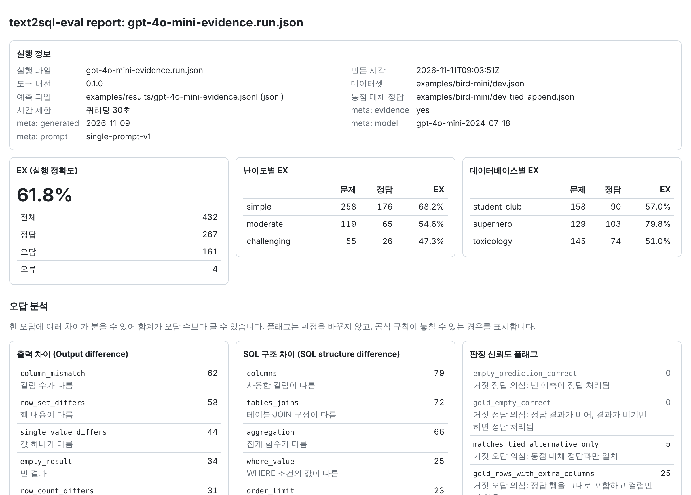

# 시작하기

저장소에 들어 있는 예제 데이터로 `eval → report → compare`를 한 번 돌려 본다. 3분이면 된다.

예제 데이터는 [BIRD](https://bird-bench.github.io/) dev의 DB 3개(`superhero`, `student_club`, `toxicology`)와 문제 432개다(CC BY-SA 4.0, 출처는 [SOURCE.md](../../examples/bird-mini/SOURCE.md)). 같은 모델(gpt-4o-mini)로 만든 예측 두 벌도 함께 들어 있다. 하나는 문제의 `evidence`(힌트)를 프롬프트에 넣은 것, 하나는 뺀 것이다([examples/results](../../examples/results/README.md)).

## 1. 설치

Python 3.11 이상이 필요하다. 저장소를 받아 설치한다.

```sh
git clone https://github.com/cheolkim02/text2sql-eval.git
cd text2sql-eval
```

[uv](https://docs.astral.sh/uv/)를 쓰면:

```sh
uv sync
uv run text2sql-eval --version
```

pip를 쓰면:

```sh
python -m venv .venv
. .venv/bin/activate   # Windows: .venv\Scripts\activate
pip install .
text2sql-eval --version
```

아래 명령은 pip로 설치한 경우다. uv를 쓰면 앞에 `uv run`을 붙인다.

## 2. 판정하기: `eval`

evidence를 넣은 예측을 판정해 실행 파일 `runs/evidence.json`을 만든다.

```sh
text2sql-eval eval \
  --dataset examples/bird-mini/dev.json \
  --db-dir examples/bird-mini/dev_databases \
  --pred examples/results/gpt-4o-mini-evidence.jsonl \
  --tied examples/bird-mini/dev_tied_append.json \
  --out runs/evidence.json
```

```text
Evaluated 432 cases: EX 61.8% (267 correct, 161 incorrect, 4 errors)
Output difference: 62 column_mismatch, 58 row_set_differs, 44 single_value_differs, 34 empty_result, 31 row_count_differs, 4 execution_failed
SQL structure difference: 79 columns, 72 tables_joins, 66 aggregation, 25 where_value, 23 order_limit
Flags: 8 gold_columns_concatenated, 25 gold_rows_with_extra_columns, 5 matches_tied_alternative_only, 13 tied_alternative_exists
Run file: runs/evidence.json
```

30초쯤 걸린다. 끝나지 않는 예측이 하나(211번) 있어서 시간 제한 30초를 기다리기 때문이다.

- EX 61.8%는 BIRD 공식 평가 스크립트의 결과와 같다([확인 기록](../../examples/results/README.md#bird-공식-스크립트와의-일치-2026-11-09)).
- 오답 161개와 실행 실패 4개에는 출력 차이와 SQL 구조 차이가 붙었다.
- 플래그는 공식 규칙이 놓쳤을 수 있는 판정을 표시한다. 예를 들어 `gold_rows_with_extra_columns` 25개는 정답 행을 다 내놓고 컬럼만 더 붙여서 오답 처리된 케이스다.

## 3. 리포트 보기: `report`

```sh
text2sql-eval report runs/evidence.json --html runs/evidence.html --csv runs/evidence.csv
```

`runs/evidence.html`을 브라우저로 연다. 인터넷 연결이 없어도 열린다.



- 처음 화면은 오답과 실행 실패 165개만 보여 준다.
- 위쪽 필터로 DB, 난이도, 차이 종류, 플래그를 고른다. 예: 플래그에서 "거짓 오답 의심 (모두)"를 고르면 38개가 남는다.
- 케이스를 펼치면 정답·예측 SQL이 절마다 줄을 나눠 나란히 보이고, 다른 절과 다른 행이 색칠돼 있다.

`runs/evidence.csv`는 엑셀에서 열면 한글이 깨지지 않는다. 비어 있는 `my_category`·`notes` 열에 손으로 분류를 적어 나가면 된다.

## 4. 두 실행 비교하기: `compare`

evidence를 뺀 실행(기준)과 넣은 실행을 비교한다. 두 실행 파일 모두 저장소에 있어서 바로 돌아간다.

```sh
text2sql-eval compare examples/results/gpt-4o-mini-no-evidence.run.json \
  examples/results/gpt-4o-mini-evidence.run.json
```

```text
Comparing examples/results/gpt-4o-mini-no-evidence.run.json -> examples/results/gpt-4o-mini-evidence.run.json (432 common cases)
EX: 37.5% -> 61.8% (+24.3 pp)
Both correct 144 | Fixed 123 | Regressed 18 | Both wrong 147
...
```

evidence를 넣자 123개가 맞게 바뀌었고, 18개는 오히려 틀리게 바뀌었다. `--csv flips.csv`를 주면 케이스마다 한 줄씩 엑셀용으로 쓴다.

## 다음 단계

- 내 실험의 예측으로 돌리기: [예측 파일 만들기](prediction-format.md)
- 차이와 플래그가 무슨 뜻인지: [결과 읽기](reading-results.md)
- 비교 결과 해석과 CI에서 쓰기: [실행 비교하기](comparing-runs.md)
- 옵션 전체: [CLI 레퍼런스](../reference/cli.md), Python에서 쓰기: [API 레퍼런스](../reference/api.md)
